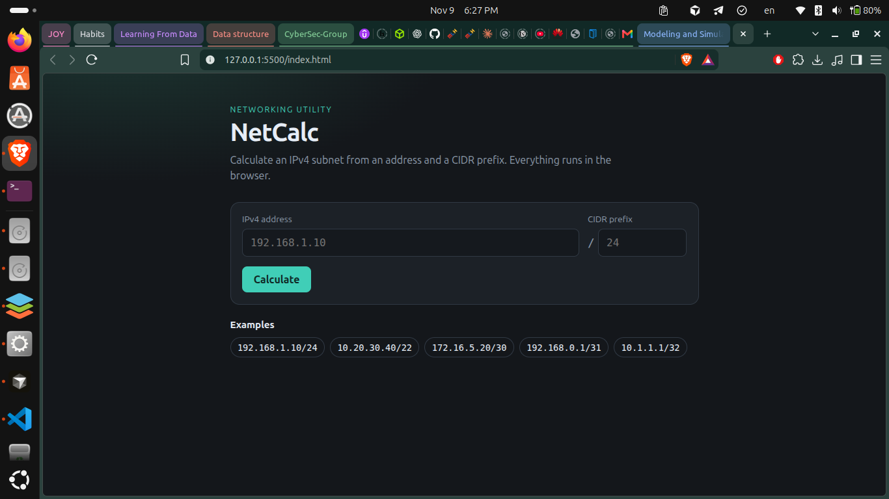
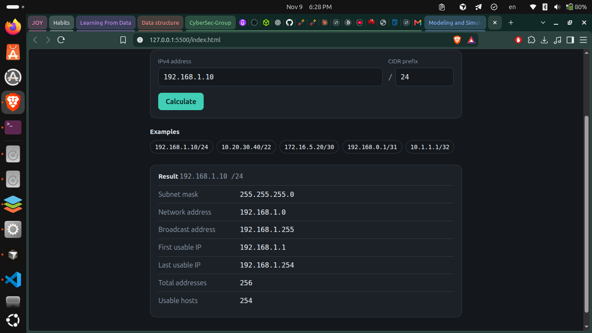
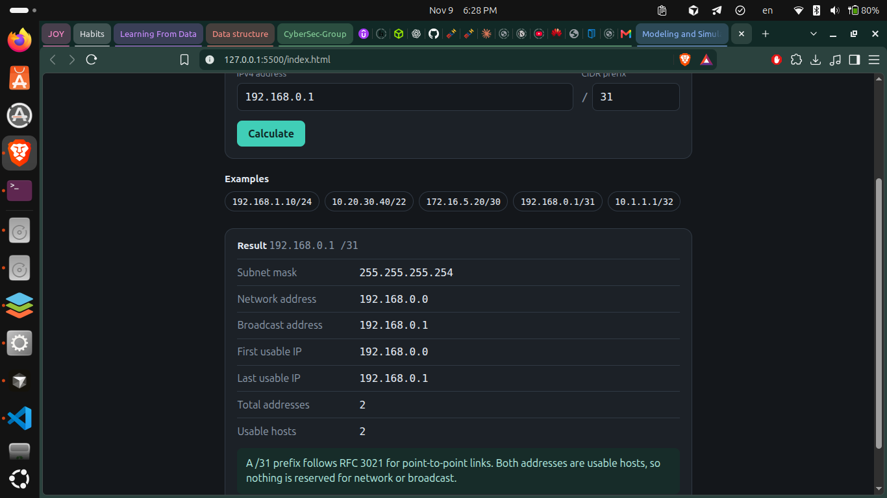

# NetCalc — IPv4 Subnet Calculator

NetCalc is a lightweight, browser-based IPv4 subnet calculator built using HTML, CSS, and vanilla JavaScript.

It helps users calculate subnet information by entering an IPv4 address and its CIDR prefix.

## Features

- IPv4 address validation.
- CIDR prefix validation (0–32).
- Subnet mask calculation.
- Network address calculation.
- Broadcast address calculation.
- First and last usable IP addresses.
- Total IP addresses and usable host count.
- Special handling for `/31` and `/32` prefixes.
- Example inputs for quick testing.
- Responsive, dark-themed interface.

## Technologies Used

- HTML5
- CSS3
- JavaScript (Vanilla)

No external libraries, frameworks, APIs, or backend services are required.

## How to Run

1. Clone the repository:

   ```bash
   git clone git@github.com:Seraphic-Omar/NetCalc.git
   ```

2. Navigate to the project directory:

   ```bash
   cd NetCalc
   ```

3. Start a local server:

   ```bash
   python3 -m http.server 8000
   ```

4. Open your browser and visit:

   `http://localhost:8000`

## Screenshots

### Main Interface



### Subnet Calculation — /30



### Subnet Calculation — /31



## How Cursor Helped

Cursor AI Agent helped scaffold the application from scratch, generate the HTML structure, CSS styling, and JavaScript subnet calculation logic.

It also assisted with implementing input validation, handling special CIDR cases, and refining the application into a functional networking utility.

## Project Purpose

This project was built as part of the MLH Week Builders challenge to explore AI-assisted development using Cursor.
